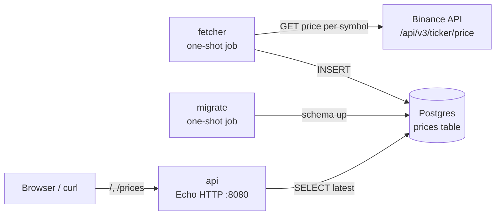

# Price Board

Tracks crypto prices, stores history, shows a live board.

> 🚧 Work in progress. Runs locally on Docker Compose today. Goal: run on Kubernetes, with all infra defined in code (Terraform, Kustomize).

## Architecture



- **Write path:** `fetcher` → Binance → Postgres
- **Read path:** browser → `api` → Postgres
- `fetcher` and `api` never talk to each other. Postgres is the only link between them.

## Components

| Component | What it does | Lifetime |
|---|---|---|
| `postgres` | Stores every fetched price (history) | Long-running |
| `migrate` | Applies SQL in `app/migrations/` with golang-migrate | Runs once, exits |
| `fetcher` | Fetches each symbol from Binance, inserts one row per symbol | Runs once, exits (will become a CronJob) |
| `api` | Serves HTML board, JSON, health checks | Long-running |

One Docker image (`price-board:dev`) holds both binaries: `/app/api` (default) and `/app/fetcher`.

## Flow

### Startup order (compose)

1. `postgres` starts and becomes healthy (`pg_isready`)
2. `migrate` runs and exits successfully
3. `api` and `fetcher` start

### Fetcher run

1. Read `SYMBOLS` (default `BTCUSDT,ETHUSDT`)
2. For each symbol: call Binance, retrying 3 times (1s, 2s backoff)
3. Insert `(symbol, price)`; `fetched_at` = DB `now()`
4. Whole run is capped at 45s
5. Exit `1` if any symbol failed (Kubernetes marks the Job failed), otherwise `0`

### API request

- Reads the newest row per symbol (`DISTINCT ON (symbol) ... ORDER BY fetched_at DESC`)
- `/` renders it as an HTML table that auto-refreshes every 60s

## API

| Path | Returns | Purpose |
|---|---|---|
| `GET /` | HTML table | Live board |
| `GET /prices` | JSON `[{symbol, price, fetched_at}]` | Latest price per symbol |
| `GET /healthz` | `200 ok` | Liveness: process up; never touches DB |
| `GET /readyz` | `200` / `503` | Readiness: DB reachable |

## Data model

| Column | Type | Note |
|---|---|---|
| `id` | `BIGSERIAL` | PK |
| `symbol` | `TEXT` | e.g. `BTCUSDT` |
| `price` | `NUMERIC` | Exact decimal, no float rounding |
| `fetched_at` | `TIMESTAMPTZ` | Default `now()` |

- Index `(symbol, fetched_at DESC)` serves the "latest per symbol" query
- Append-only: each fetch adds rows; nothing is updated

## Configuration

| Var | Used by | Default | Required |
|---|---|---|---|
| `POSTGRES_USER` / `_PASSWORD` / `_DB` | compose | none | Yes |
| `DATABASE_URL` | api, fetcher | none, fails at startup | Yes (compose builds it) |
| `SYMBOLS` | fetcher | `BTCUSDT,ETHUSDT` | No |
| `BINANCE_PRICE_URL` | fetcher | Binance ticker URL | No |
| `PORT` | api | `8080` | No |

See [.env.example](.env.example) for who reads which file.

## Run locally

```bash
cp .env.example .env                 # set a real password
docker compose up -d --build         # postgres → migrate → api
docker compose run --rm fetcher      # fetch once
open http://localhost:8080           # or: curl localhost:8080/prices
```

- Tests: `cd app && go test ./...`
- Stop: `docker compose down` (add `-v` to wipe DB data)

## Design choices

| Choice | Why |
|---|---|
| Fetcher is one-shot, not a loop | Scheduling belongs to the platform (CronJob), not the app |
| No default for `DATABASE_URL` | Missing secret fails loudly at boot |
| DB ping at startup | Bad URL fails at boot, not on first request |
| Liveness ≠ readiness | DB outage removes pod from traffic without restart loops |
| SIGTERM handling | Clean shutdown when Kubernetes stops a pod |
| Distroless, non-root image | No shell, no compiler: smaller attack surface |
| Ports bound to `127.0.0.1` | Not exposed to the local network |
| Pre-commit: gitleaks, gofmt, terraform fmt | Catch secrets and format issues before commit |

## Repo layout

```
app/
  cmd/api/          HTTP server + index.html template
  cmd/fetcher/      one-shot price fetcher
  internal/binance/ Binance HTTP client
  internal/store/   Postgres access (pgx pool)
  internal/retry/   retry with exponential backoff
  internal/env/     env var helper
  migrations/       SQL schema (golang-migrate)
terraform/          infra (in progress)
docker-compose.yml  local stack
```

## Stack

- **App:** Go (Echo, pgx), Postgres 18
- **Infra:** kind, Terraform, Kustomize
- **Delivery:** GitHub Actions, Argo CD
- **Ops:** Prometheus, Grafana, Sealed Secrets

## License

[MIT](LICENSE)
